<div class="cover">
  <p class="cover-school">TRƯỜNG ĐẠI HỌC CÔNG NGHỆ THÔNG TIN VÀ TRUYỀN THÔNG</p>
  <p class="cover-faculty"><u>KHOA CÔNG NGHỆ THÔNG TIN</u></p>
  
  <h1>BÁO CÁO</h1>
  <p class="cover-course">MÔN: TRIỂN KHAI VÀ QUẢN TRỊ HỆ THỐNG PHẦN MỀM</p>
  <p class="cover-project">ĐỀ TÀI: HỆ THỐNG QUẢN LÝ SỰ KIỆN/EVEN</p>
  <table class="cover-people">
    <tr>
      <td>
        <strong>Sinh viên thực hiện:</strong>
        <p>Diệp Chí Vỹ (CNTT K23N)</p>
        <p>MSSV: DTC245200892</p>
      </td>
      <td>
        <strong>Giảng viên:</strong>
        <p>Vũ Văn Diện</p>
      </td>
    </tr>
  </table>
  <p class="cover-location">Thái Nguyên – 2026</p>
</div>

<div class="page-break"></div>

## Mục lục

1. Giới thiệu đề tài
2. Yêu cầu và phạm vi
3. Phân tích, thiết kế kiến trúc
4. Triển khai ứng dụng và cơ sở dữ liệu
5. Reverse proxy Nginx và bảo vệ HTTP
6. Giám sát Prometheus và Grafana
7. Thu thập log bằng Loki và Promtail
8. Hardening và giới hạn bảo mật
9. Kiểm thử và đối chiếu yêu cầu
10. Kết luận và hướng phát triển
11. Phụ lục triển khai

## 1. Giới thiệu đề tài

### 1.1 Bối cảnh

Các hội thảo, workshop và ngày hội cần một nơi tập trung để công bố thông tin, theo dõi số lượng người đăng ký và quản lý số chỗ còn lại. Đề tài xây dựng ứng dụng web nhỏ để mô phỏng quy trình này, đồng thời thực hành đóng gói và vận hành nhiều dịch vụ bằng Docker Compose.

Ngoài chức năng nghiệp vụ, dự án tích hợp cơ sở dữ liệu quan hệ, reverse proxy, công cụ quản trị cơ sở dữ liệu, thu thập số liệu, dashboard, tập trung log và một số cấu hình hardening. Các dịch vụ được khai báo cùng nhau để có thể khởi chạy, kiểm tra và dừng theo một quy trình thống nhất.

### 1.2 Mục tiêu

- Quản lý danh sách sự kiện, tạo/xóa sự kiện và theo dõi lượt đăng ký.
- Ghi nhận người tham dự, kiểm tra sức chứa và cấp mã vé.
- Lưu dữ liệu trong PostgreSQL và cung cấp pgAdmin để quản trị DB.
- Đặt Nginx phía trước ứng dụng Node.js/Express làm reverse proxy.
- Giám sát ứng dụng, PostgreSQL và container bằng Prometheus/Grafana.
- Tập trung log bằng Loki/Promtail và hỗ trợ truy vấn LogQL.
- Áp dụng hardening cơ bản và lưu trữ mã nguồn trên GitHub qua ba giai đoạn triển khai.

### 1.3 Phạm vi và giới hạn

Phạm vi bao gồm quản lý sự kiện, đăng ký, mã vé, PostgreSQL, pgAdmin, proxy, metrics, logging và hardening cơ bản. Bản mẫu chưa có xác thực/phân quyền quản trị, thanh toán, gửi email vé hoặc khôi phục mật khẩu. Hiện website dùng HTTP cục bộ, chưa bật HTTPS. Không triển khai công khai trên Internet trước khi bổ sung xác thực, TLS, giới hạn truy cập, sao lưu và rà soát bảo mật.

## 2. Yêu cầu và phạm vi triển khai

### 2.1 Môi trường

- Windows với Docker Desktop và Docker Compose v2.
- Git và trình duyệt web.
- Tài nguyên máy đủ chạy PostgreSQL, Node.js, Nginx, Grafana, Prometheus, Loki, Promtail, pgAdmin, postgres-exporter và cAdvisor cùng lúc.

### 2.2 Thành phần

| Thành phần | Vai trò |
|---|---|
| Node.js/Express | Giao diện, API nghiệp vụ, health check và metrics |
| PostgreSQL | Lưu dữ liệu sự kiện và đăng ký |
| pgAdmin | Giao diện quản trị PostgreSQL |
| Nginx | Reverse proxy và security headers |
| Prometheus | Scrape metrics ứng dụng và exporter |
| Grafana | Datasource và giao diện dashboard/Explore |
| postgres-exporter | Xuất metrics PostgreSQL |
| cAdvisor | Metrics container; cần quyền host rộng |
| Promtail | Đọc file log Docker và chuyển log tới Loki |
| Loki | Lưu trữ và cung cấp truy vấn log |

## 3. Phân tích và thiết kế kiến trúc

### 3.1 Luồng xử lý

Người dùng truy cập cổng HTTP `8080` trên máy phát triển. Nginx nhận yêu cầu và chuyển tiếp đến `app:3000`. Ứng dụng truy vấn PostgreSQL thông qua mạng backend. pgAdmin kết nối tới DB để quản trị; PostgreSQL không publish cổng ra host.

Prometheus lấy số liệu từ ứng dụng tại `/metrics`, postgres-exporter và cAdvisor. Grafana được cấu hình datasource Prometheus và Loki. Promtail đọc file log Docker qua bind mount chỉ đọc và gửi tới Loki.

```text
Trình duyệt --HTTP:8080--> Nginx --frontend--> Node.js/Express:3000
                                                   |       |
                                               backend   monitoring
                                                   |       |
                                              PostgreSQL  Prometheus
                                                  ^       ^    |
                                               pgAdmin  exporters Grafana

Docker Engine --read-only log mount--> Promtail --> Loki --> Grafana Explore
```

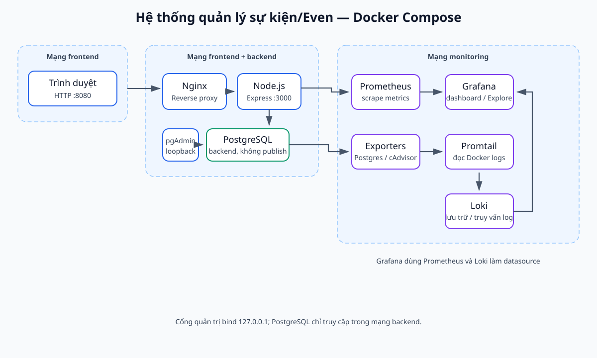

*Hình 1. Sơ đồ kiến trúc hệ thống quản lý sự kiện/Even.*

### 3.2 Mạng và cổng

Compose định nghĩa `frontend`, `backend` và `monitoring`. Backend được đặt `internal`; ứng dụng kết nối đồng thời với DB, proxy và monitoring. Các cổng host là website `8080`, pgAdmin `127.0.0.1:5050`, Prometheus `127.0.0.1:9090`, Grafana `127.0.0.1:3001` và Loki `127.0.0.1:3100`. Website bind mọi interface host; các giao diện vận hành chỉ bind loopback.

## 4. Triển khai ứng dụng và cơ sở dữ liệu

### 4.1 Mô hình dữ liệu

Bảng `events` lưu tên, địa điểm, thời gian, sức chứa, mô tả và thời điểm tạo; sức chứa phải dương. Bảng `registrations` lưu sự kiện, họ tên, email, mã vé và thời điểm tạo. Khóa ngoại `event_id` tham chiếu `events(id)`; xóa sự kiện sẽ xóa đăng ký liên quan nhờ `ON DELETE CASCADE`.

| Bảng | Trường chính | Ràng buộc |
|---|---|---|
| `events` | `id`, `name`, `location`, `event_date`, `capacity`, `description`, `created_at` | Khóa chính; trường nghiệp vụ bắt buộc; sức chứa dương |
| `registrations` | `id`, `event_id`, `attendee_name`, `attendee_email`, `ticket_code`, `created_at` | Khóa chính; khóa ngoại; mã vé duy nhất |

### 4.2 Chức năng và API

- `GET /`: hiển thị tổng số sự kiện, lượt đăng ký, form và danh sách.
- `GET /api/events`: danh sách sự kiện kèm số đăng ký.
- `POST /api/events`: tạo sự kiện; dữ liệu không hợp lệ trả HTTP 400.
- `DELETE /api/events/:id`: xóa sự kiện; không có sự kiện trả HTTP 404.
- `POST /api/events/:id/register`: kiểm tra sự kiện/sức chứa trong transaction và tạo mã vé.
- `GET /api/registrations`: danh sách đăng ký kèm tên sự kiện.
- `GET /health`: kiểm tra kết nối PostgreSQL.
- `GET /metrics`: cung cấp `even_events_total` và `even_registrations_total`.

Khi đăng ký, ứng dụng khóa dòng sự kiện bằng `FOR UPDATE` trước khi kiểm tra sức chứa nhằm tuần tự hóa các yêu cầu cạnh tranh cho cùng sự kiện. Mã vé của bản mẫu là định danh đơn giản, chưa phải vé ký số hoặc quy trình xác thực vé dùng trong sản phẩm thực tế.

### 4.3 Khởi chạy và pgAdmin

Tạo `.env` từ `.env.example`, thay mật khẩu mẫu bằng mật khẩu mạnh, riêng biệt, sau đó kiểm tra và chạy:

```powershell
Copy-Item .env.example .env
notepad .env
docker compose config
docker compose up -d --build
docker compose ps
```

pgAdmin tại `http://localhost:5050`. Khi thêm server, nhập host `db`, port `5432`, database `even_db`, user `even_app`, và giá trị `DB_PASSWORD` trong `.env`. Tài khoản pgAdmin lấy từ `PGADMIN_EMAIL` và `PGADMIN_PASSWORD`.

Sau khi đăng nhập, pgAdmin kết nối tới PostgreSQL và hiển thị cơ sở dữ liệu `even_db`, schema `public` cùng hai bảng `events`, `registrations`. Truy vấn kiểm tra số lượng ghi nhận 3 sự kiện và 3 lượt đăng ký; các ảnh cây đối tượng không hiển thị dữ liệu cá nhân.

| Bảng | Số bản ghi sau khi dọn dữ liệu kiểm thử |
|---|---:|
| `events` | 3 |
| `registrations` | 3 |

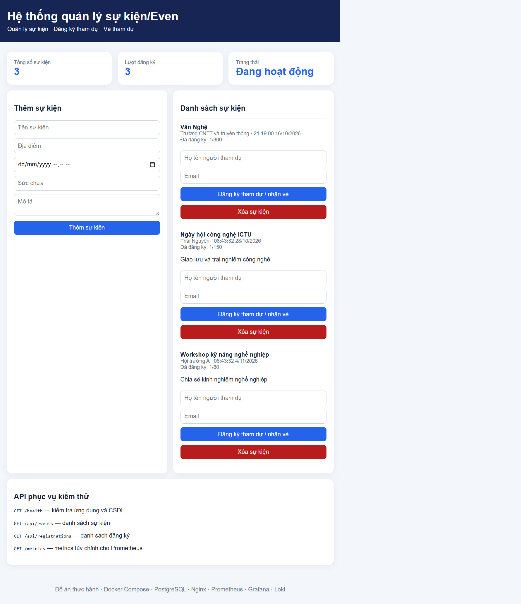

*Hình 2. Website thực tế tại `localhost:8080`, hiển thị danh sách sự kiện và lượt đăng ký.*

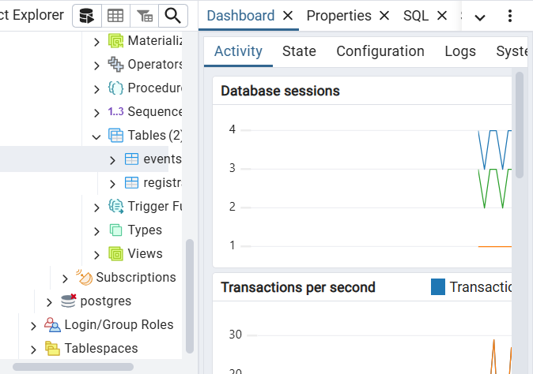

*Hình 3a. Kết nối pgAdmin tới `even_db` và schema `public`.*

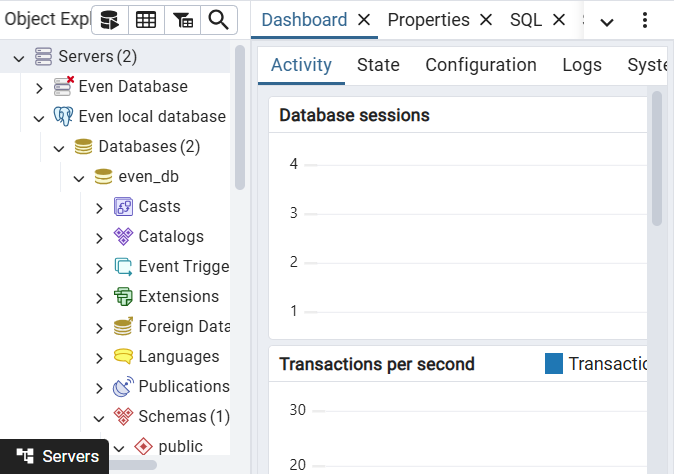

*Hình 3b. Cây đối tượng hiển thị `Tables (2)` cùng hai bảng nghiệp vụ.*

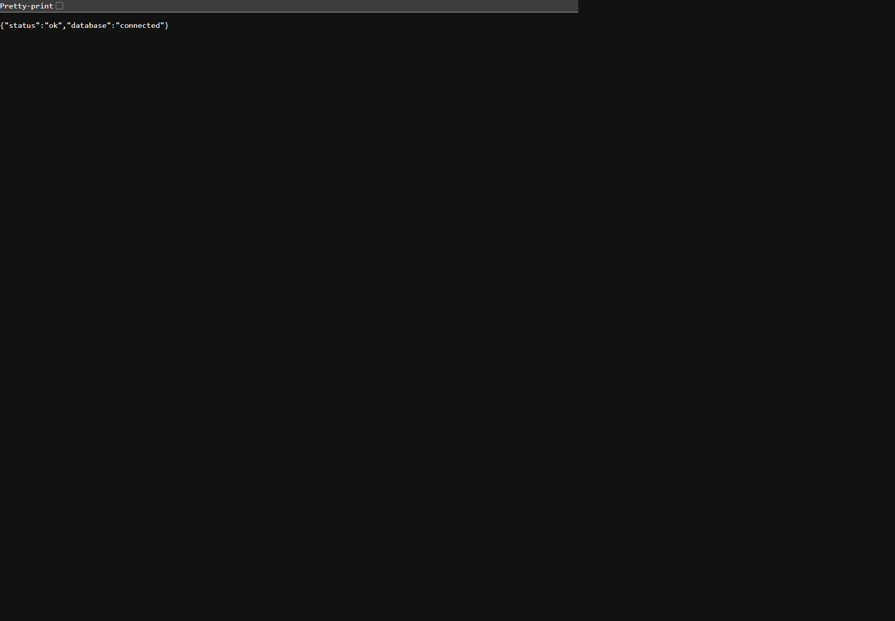

*Hình 4. Phản hồi thực tế từ `/health`: ứng dụng hoạt động và kết nối PostgreSQL.*

## 5. Reverse proxy Nginx và bảo vệ HTTP

Nginx nghe cổng 80 trong container, publish ra host tại `8080`, rồi chuyển tiếp yêu cầu đến `http://app:3000`. Proxy giữ Host, chuyển địa chỉ IP và giao thức yêu cầu; timeout kết nối 5 giây, timeout đọc 30 giây. Request body bị giới hạn 1 MiB.

Các header cấu hình gồm `X-Content-Type-Options: nosniff`, `X-Frame-Options: DENY`, `Referrer-Policy: no-referrer` và `Permissions-Policy` tắt camera, microphone, geolocation. Header cũng được đặt ở ứng dụng nên phản hồi có thể lặp header; có thể tinh chỉnh để chỉ thiết lập tại một lớp. Website dùng HTTP cục bộ, không có TLS và không được mô tả là HTTPS.

Lệnh xác minh:

```powershell
curl.exe -I http://localhost:8080/
```

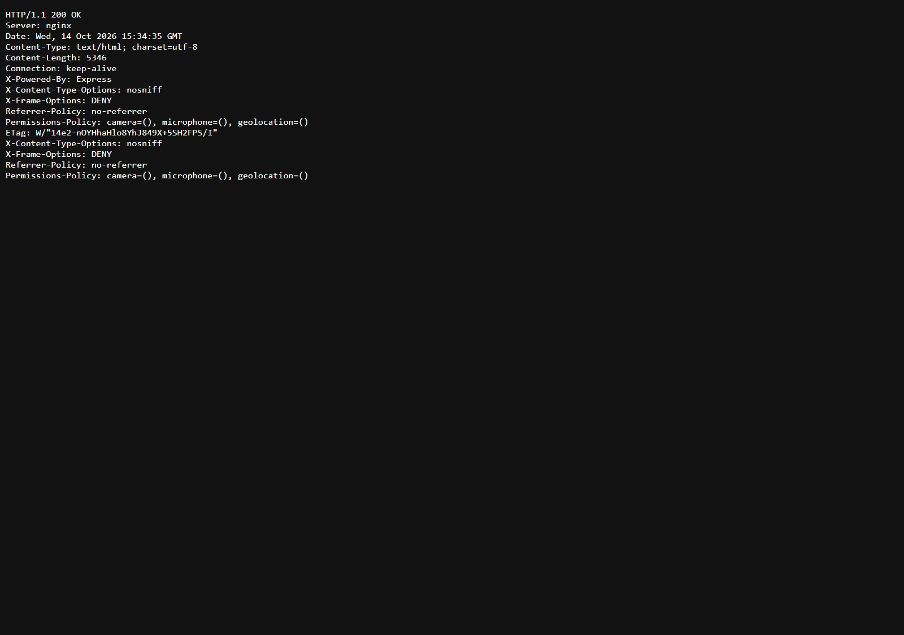

*Hình 6. Phản hồi HTTP 200 và các security headers lấy bằng `curl.exe -I`; một số header lặp lại vì được đặt ở cả Nginx và ứng dụng.*

## 6. Giám sát Prometheus và Grafana

Prometheus scrape mỗi 15 giây với bốn job: `prometheus` (`localhost:9090`), `even_app` (`app:3000/metrics`), `postgres` (`postgres-exporter:9187`) và `containers` (`cadvisor:8080`). Có thể kiểm tra tại `http://localhost:9090/targets`.

Hai metric tùy chỉnh là `even_events_total` và `even_registrations_total`. Các truy vấn gợi ý:

```promql
up
even_events_total
even_registrations_total
pg_up
sum by (id) (container_memory_usage_bytes)
```

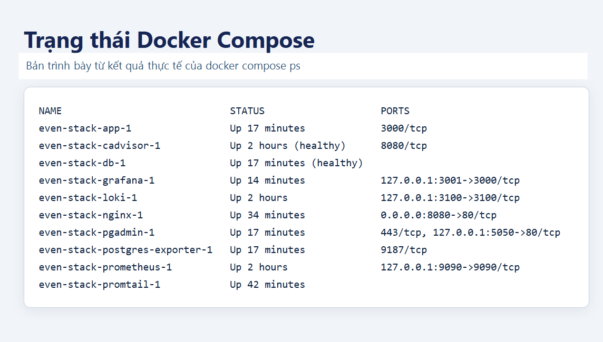

*Hình 5. Bản trình bày đầu ra `docker compose ps` lấy trực tiếp từ stack đang chạy.*

Grafana được provision datasource Prometheus và Loki. Dashboard `Even - System Overview` được provision tự động với panels tổng sự kiện, lượt đăng ký, trạng thái scrape targets, `pg_up` và memory container. API Grafana đã xác nhận dashboard có 5 panels, cùng datasource Prometheus/Loki. Endpoint health trả database `ok`; cả bốn Prometheus target có trạng thái `up`.

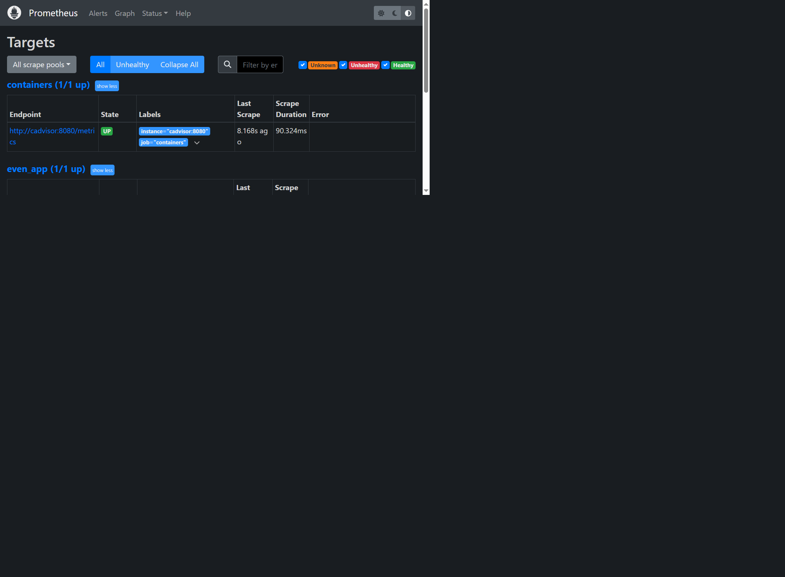

*Hình 7. Ảnh chụp trang Targets; cả bốn job được xác nhận `UP`.*

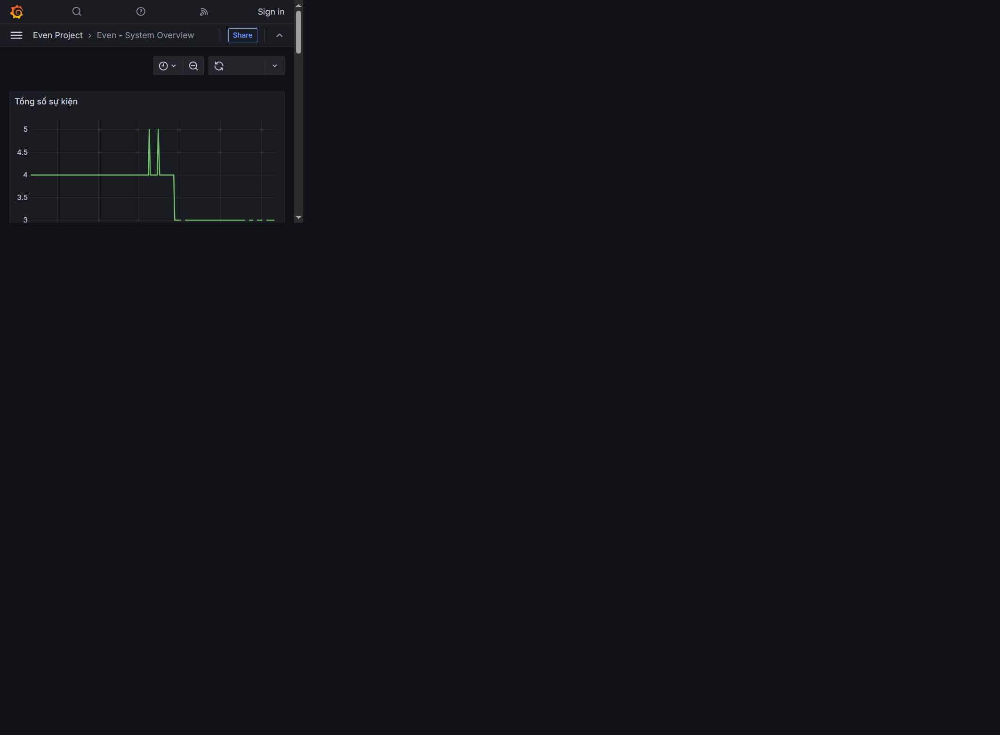

*Hình 8. Dashboard Grafana thực tế; ảnh chụp panel metric tổng sự kiện. Dashboard được provision với tổng cộng năm panels.*

## 7. Thu thập log bằng Loki và Promtail

Promtail đọc các file JSON log tại `/var/lib/docker/containers/*/*-json.log`, được mount vào container ở chế độ chỉ đọc. Đường dẫn log Linux có thể khác giữa các môi trường Docker Desktop/Windows; trong môi trường kiểm tra hiện tại, Promtail nhìn thấy và đẩy được log từ đường dẫn này. Promtail gửi log tới `http://loki:3100/loki/api/v1/push`; Loki lưu trữ trên volume riêng.

Endpoint Loki `/ready` trả `ready`; cả ba truy vấn dưới đây được chạy trực tiếp qua Loki API. Truy vấn lọc sự kiện và đăng ký đều trả về log khớp. Hai ảnh Explore ghi lại truy vấn thực tế; bảng kết quả đi kèm cho biết số dòng khớp trong cửa sổ kiểm thử (truy vấn tổng quát giới hạn ở 100 dòng).

```logql
{job="docker"}
{job="docker"} |= "event_created"
{job="docker"} |= "registration_created"
```

Tạo sự kiện và đăng ký thử, chờ log được đẩy, sau đó tìm trong khoảng thời gian tương ứng. Nếu máy khác không thấy stream, kiểm tra `docker compose logs promtail loki` và xác minh host có mount được đường dẫn log.

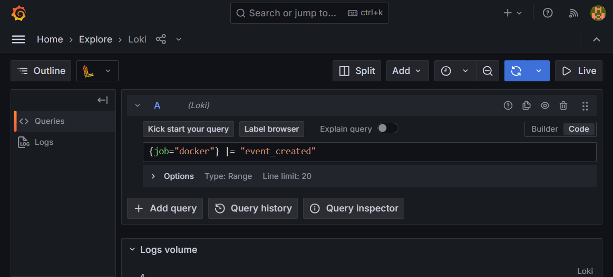

*Hình 9. Truy vấn LogQL đã chọn trong Grafana Explore.*

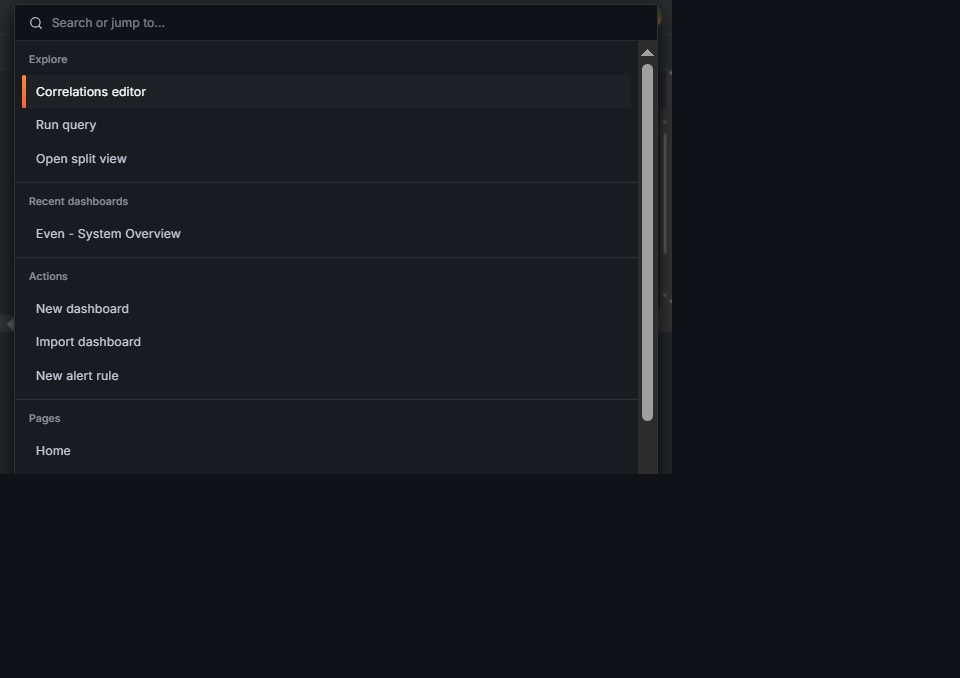

*Hình 10. Truy vấn LogQL thứ hai trong Grafana Explore.*

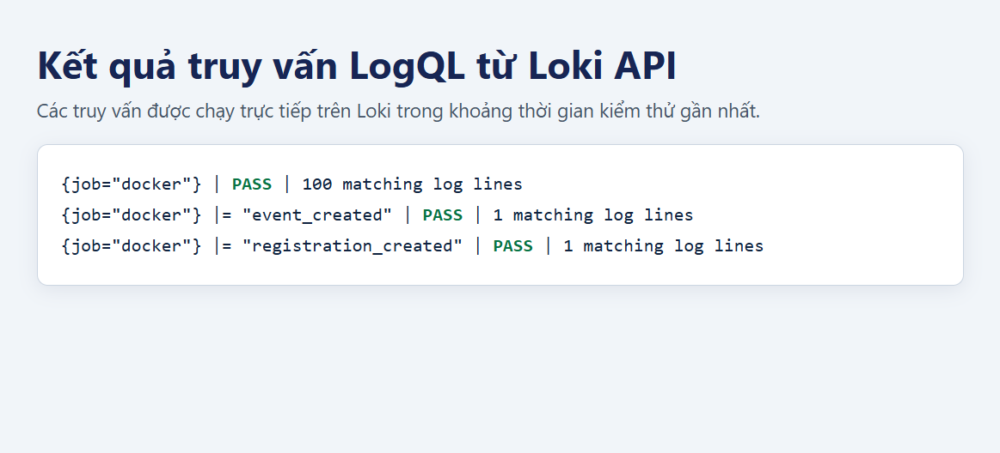

*Hình 11. Kết quả kiểm tra trực tiếp: truy vấn tổng quát trả 100 dòng theo giới hạn; mỗi truy vấn lọc trả 1 dòng trong cửa sổ kiểm thử.*

## 8. Hardening và giới hạn bảo mật

Các biện pháp được cấu hình: ứng dụng chạy user `node`, Nginx chạy UID/GID `101:101`; filesystem app/Nginx read-only; app và Nginx có `no-new-privileges` và drop capabilities; Nginx chỉ được cấp lại `NET_BIND_SERVICE` để bind cổng 80; app dùng tmpfs cho `/tmp`, Nginx dùng tmpfs có quyền sở hữu phù hợp cho cache/runtime; backend network internal; DB không publish cổng host; giao diện quản trị bind loopback; mật khẩu riêng, mạnh được lưu trong `.env` cục bộ và `.env` nằm trong `.gitignore`; Nginx giới hạn body request và thêm security headers; DB healthcheck giúp app đợi DB sẵn sàng.

Các ngoại lệ cần nêu rõ:

- cAdvisor chạy `privileged: true`, dùng `/dev/kmsg` và bind mount host để đọc số liệu. Đây là quyền rộng, chỉ phù hợp môi trường thực hành.
- Promtail được cấp quyền đọc các file log Docker qua bind mount chỉ đọc; đường dẫn host có thể khác trên máy khác.
- Nginx được chạy trực tiếp dưới UID/GID không phải root, bỏ entrypoint mặc định và chỉ được cấp lại `NET_BIND_SERVICE`. Cấu hình dùng tmpfs có UID/GID phù hợp cho cache và runtime.
- HTTP chưa có HTTPS; website chưa có xác thực/phân quyền quản trị.

Trích cấu hình hardening trong `docker-compose.yml` (các giá trị bí mật được tham chiếu từ `.env`, không chép mật khẩu vào báo cáo):

```yaml
app:
  read_only: true
  tmpfs: [/tmp]
  security_opt: [no-new-privileges:true]
  cap_drop: [ALL]
nginx:
  user: "101:101"
  read_only: true
  security_opt: [no-new-privileges:true]
  cap_drop: [ALL]
  cap_add: [NET_BIND_SERVICE]
```

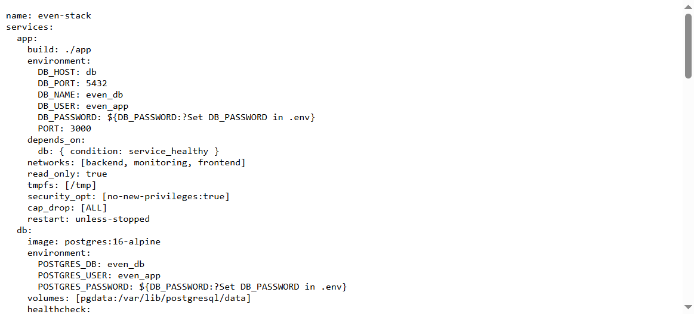

*Hình 12a. Ảnh chụp phần cấu hình ứng dụng trong `docker-compose.yml`; mật khẩu chỉ là tham chiếu biến môi trường.*

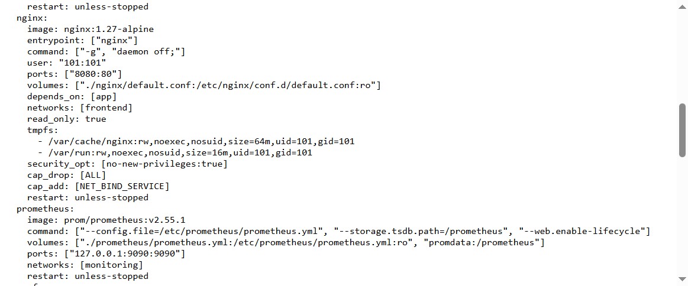

*Hình 12b. Ảnh chụp phần cấu hình Nginx: non-root, read-only filesystem, drop capabilities và chỉ cấp `NET_BIND_SERVICE`.*

## 9. Kiểm thử và đối chiếu yêu cầu

### 9.1 Ma trận kiểm thử

| Mã | Kiểm thử | Kết quả quan sát | Bằng chứng |
|---|---|---|---|
| T01 | Mở trang chủ `localhost:8080` | Pass: trang chủ tải qua Nginx | Hình 2 |
| T02 | `GET /health` | Pass: `status=ok`, `database=connected` | Hình 4 |
| T03 | `curl.exe -I` qua Nginx | Pass: HTTP 200 và security headers | Hình 6 |
| T04 | Prometheus targets | Pass: 4/4 targets `UP` | Hình 7 |
| T05 | Grafana và dashboard | Pass: Grafana `database=ok`, dashboard 5 panels đã provision | Hình 8 |
| T06 | Loki readiness | Pass: `/ready` trả `ready` trong lần kiểm tra | Đối chiếu endpoint Loki |
| T07 | Tạo sự kiện hợp lệ | Pass: HTTP 201; bản ghi kiểm thử đã xóa | Hình 13 |
| T08 | Tạo sự kiện thiếu dữ liệu | Pass: HTTP 400 | Hình 13 |
| T09 | Đăng ký và cấp mã vé | Pass: HTTP 201; bản ghi thử đã xóa | Hình 13 |
| T10 | Đăng ký vượt sức chứa | Pass: HTTP 409 với sức chứa 1 | Hình 13 |
| T11 | Truy vấn LogQL | Pass: truy vấn tổng quát và 2 bộ lọc trả log | Hình 9–11 |
| T12 | Bảo vệ `.env` | `.env` bị Git ignore và không được theo dõi | `git check-ignore .env`; `git ls-files .env` rỗng |

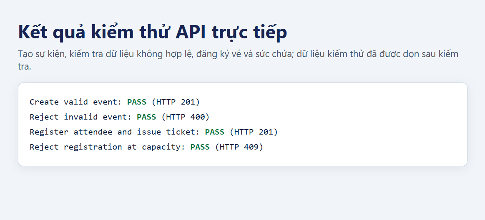

*Hình 13. Tổng hợp bốn kết quả API đã kiểm tra (HTTP 201, 400, 201 và 409); dữ liệu thử đã được dọn.*

Các phép thử T01–T05 và T07–T12 được chạy/xác nhận trên môi trường phát triển. Các bản ghi thử nghiệm cho T07–T10 đã được dọn; số liệu DB sau dọn được trả về 3 sự kiện và 3 lượt đăng ký.

### 9.2 Đối chiếu từng yêu cầu đề bài

| Yêu cầu | Trạng thái | Ghi chú cuối |
|---|---|---|
| Mã nguồn/cấu hình trên GitHub, README rõ | Có | Repo đã có; xác minh thay đổi mới nhất được push |
| Website, Database, công cụ quản lý DB chạy bằng Compose | Đạt ở lần kiểm tra | App, PostgreSQL, pgAdmin |
| Nginx reverse proxy: HTTPS tự ký hoặc security headers | Đạt theo nhánh headers | HTTP, không có HTTPS |
| Prometheus + Grafana giám sát container, web, DB | Đạt: 4 targets `up`, dashboard 5 panels đã provision | Đã chèn ảnh Targets và dashboard |
| Loki + Promtail, 2–3 truy vấn LogQL | Đạt: 3 truy vấn trả log trong kiểm thử | Ảnh Explore và kết quả API ở Hình 9–11 |
| Hardening: non-root, isolation, secrets, headers | Đạt một phần, có ngoại lệ | Nêu cAdvisor, thư mục log, Nginx capabilities |
| Báo cáo tối thiểu 10 trang có bìa và hình | Đã xuất bản PDF A4; xác nhận đạt tối thiểu 10 trang | Đối chiếu bìa với mẫu chính thức của khoa |

### 9.3 GitHub và các commit

Repository: <https://github.com/dtc245200892-jpg/he-thong-quan-ly-su-kien-even>

1. `commit 1: deploy app database and nginx reverse proxy`
2. `commit 2: add prometheus grafana monitoring`
3. `commit 3: add loki promtail logging and hardening`
4. `complete event management report and monitoring setup`

Không commit `.env` hoặc ảnh có mật khẩu/token. Ảnh dưới đây chụp lịch sử GitHub công khai tại thời điểm hoàn thiện nội dung báo cáo.

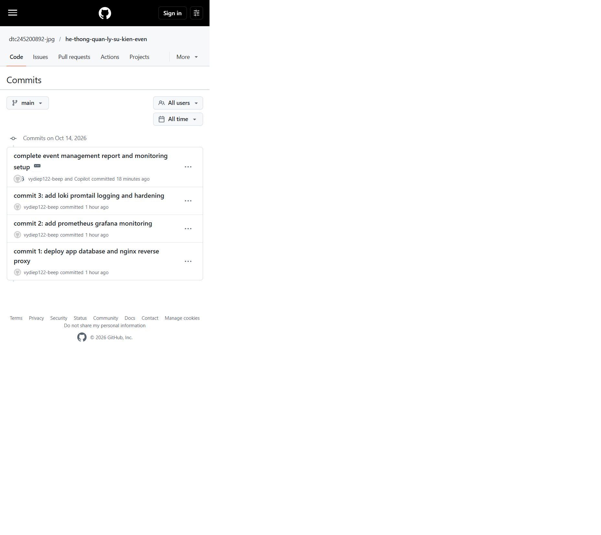

*Hình 14. Repository GitHub và lịch sử bốn commit hiển thị trên nhánh `main`.*

## 10. Kết luận và hướng phát triển

Đề tài đã tạo bộ triển khai nhiều container cho hệ thống quản lý sự kiện/Even. Ứng dụng kết nối PostgreSQL; Nginx làm reverse proxy và thêm security headers; Prometheus scrape ứng dụng và exporter; Grafana provision datasource và dashboard; Loki/Promtail đã trả log thực tế qua LogQL. Một số hardening được áp dụng, đồng thời các ngoại lệ quyền cAdvisor và truy cập thư mục log Docker đã được nhận diện.

Báo cáo kèm ảnh pgAdmin, Compose, hardening và kiểm thử LogQL/API. Không khẳng định HTTPS hoặc xác thực quản trị vì hai tính năng này chưa được triển khai.

Hướng phát triển: xác thực và phân quyền; sửa sự kiện; chống đăng ký trùng email; mã QR vé có cơ chế xác minh; TLS; backup/restore; dashboard/alerts; CI/CD; và giảm quyền container trước khi công khai.

## 11. Phụ lục triển khai

### 11.1 Cấu trúc repository

```text
even_project/
  app/                  Node.js/Express và Dockerfile
  db/                   SQL tham khảo
  nginx/                Reverse proxy và security headers
  prometheus/            Cấu hình scrape
  grafana/provisioning/  Datasource Prometheus và Loki
  grafana/dashboards/    Dashboard Even - System Overview
  loki/                  Cấu hình lưu trữ log
  promtail/              Docker discovery và chuyển log
  docker-compose.yml     Services, networks, volumes, hardening
  .env.example           Mẫu biến môi trường
  README.md              Hướng dẫn chạy
  REPORT_OUTLINE.md      Dàn ý
  REPORT.md              Bản thảo báo cáo
```

### 11.2 Lệnh kiểm tra

```powershell
docker compose config
docker compose up -d --build
docker compose ps
curl.exe http://localhost:8080/health
curl.exe http://localhost:8080/api/events
curl.exe -I http://localhost:8080/
curl.exe http://localhost:8080/metrics
docker compose logs --tail=100 app nginx promtail loki
```

`docker compose down` dừng dịch vụ. `docker compose down -v` xóa cả dữ liệu volumes PostgreSQL và monitoring/log; chỉ dùng khi chấp nhận mất dữ liệu.

### 11.3 Ảnh và bằng chứng đã chèn

- `report-images/01-architecture.svg`: sơ đồ kiến trúc và luồng dữ liệu.
- `report-images/02-website.png`: giao diện website đang chạy.
- `report-images/04-health-check.png`: health check ứng dụng và kết nối DB.
- `report-images/05-http-headers.png`: kết quả thực tế từ `curl.exe -I`.
- `report-images/06-prometheus-targets.png`: giao diện Prometheus Targets.
- `report-images/07-grafana-dashboard.png`: panel metric trong dashboard Grafana.
- `report-images/08-compose-ps.png`: trạng thái dịch vụ Docker Compose.
- `report-images/09-pgadmin-db-tables.png`, `09a-pgadmin-tables.png`: pgAdmin hiển thị kết nối DB/schema và hai bảng.
- `report-images/10-hardening-app.png`, `10-hardening-nginx.png`: ảnh chụp các đoạn cấu hình hardening từ `docker-compose.yml`.
- `report-images/11-github-commits.png`: lịch sử commit công khai trên GitHub.
- `report-images/12-api-tests.png`: kiểm thử API thực tế và dọn dữ liệu.
- `report-images/13-grafana-explore-event-log.png`, `14-grafana-explore-registration-log.png`: truy vấn Grafana Explore.
- `report-images/15-logql-results.png`: số dòng trả về từ ba truy vấn LogQL qua Loki API.

Các bản ghi người tham dự và thông tin xác thực không được đưa vào ảnh. Số liệu có thể thay đổi khi chạy lại ứng dụng.
